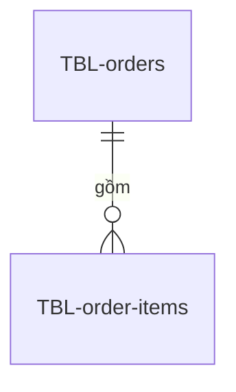

# Sơ đồ quan hệ của order-db

## Sơ đồ quan hệ
<!-- required -->

## Khóa ngoại
<!-- required -->

| Cột khóa ngoại | Bảng con | Bảng cha | Khi xóa bảng cha | Kiểu |
| --- | --- | --- | --- | --- |
| order_items.order_id | TBL-order-items | TBL-orders | xóa theo | integer, 4 byte, xem [data-sizing.md](../../../03-capacity/data-sizing.md) |
