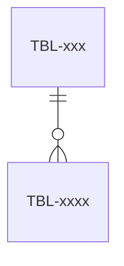

# Sơ đồ quan hệ của <db>

> Template của design-architecture. Mục có `<!-- required -->` là bắt buộc. Nhắc bảng bằng ID `TBL-xx` (định nghĩa ở [tables.md](tables.md)). Không đặt ID ở ô đầu dòng bảng.

## Sơ đồ quan hệ
<!-- required -->

## Khóa ngoại
<!-- required -->

Kiểu cột khóa ngoại phải trùng kiểu cột khóa chính được tham chiếu (cùng số byte). Không có khóa ngoại thì ghi "không có khóa ngoại" kèm lý do (ví dụ khóa ngoại chéo database).

| Cột khóa ngoại | Bảng con | Bảng cha | Khi xóa bảng cha | Kiểu |
| --- | --- | --- | --- | --- |
| <bảng.cột> | <TBL-xx> | <TBL-xx> | <chặn, xóa theo, đặt rỗng> | <kiểu, byte> |
